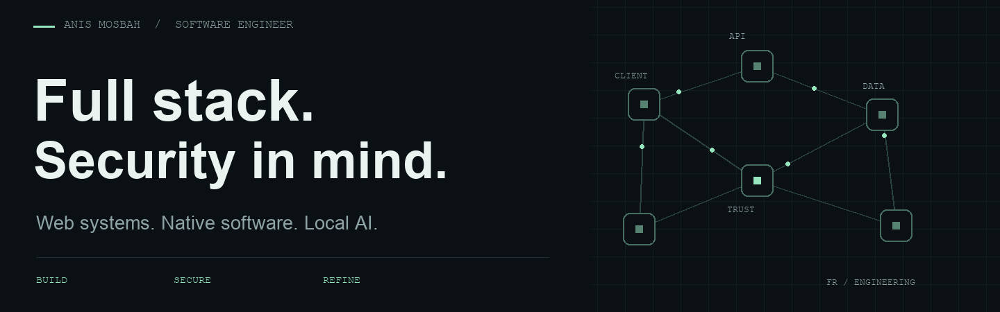
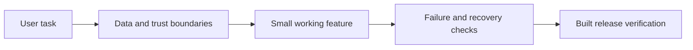

# Engineering Playbook

### Build the feature. Understand the boundary. Verify the release.

Practical field notes by **Anis Mosbah** on full-stack development, application security, local AI and macOS distribution.

These guides turn broad engineering goals into decisions you can review and checks you can repeat. Each includes a concrete scenario, a decision table and a copyable checklist.

| Start here | You will leave with |
| :--- | :--- |
| [Full-stack security](fullstack-security.md) | A clear trust boundary and a small authorization test plan. |
| [Local AI product design](local-ai.md) | A data-flow map, a failure-state plan and an evaluation template. |
| [macOS release readiness](macos-release.md) | A release gate covering installation, permissions, updates and recovery. |

## A useful order of operations

Before choosing a framework, write down the user’s task and the data it needs. Before adding a capability, decide who is allowed to use it. Before shipping, exercise the built application on a machine that does not have your development environment.

## Use the guides

1. Choose the guide closest to your next delivery.
2. Copy its checklist into an issue or release note.
3. Record evidence for each item: a test, a screenshot or a reproducible result.
4. Keep unresolved decisions visible instead of marking them complete.

The examples are illustrative engineering notes, not audited reference implementations. Adapt them to your architecture and the versions you actually ship. Vendor references are linked in each guide.

## Contributions

Corrections and small, concrete examples are welcome through issues and pull requests. Include the relevant software version and a reproducible case. Do not post credentials, private logs, customer data or unpatched vulnerability details in a public issue. Follow the affected vendor’s disclosure process for security reports.

## Author

**Anis Mosbah** · Full-stack software engineer  
Web · Desktop · AI · Application security  
[Professional enquiries](mailto:contact@anis-mosbah.dev) · [GitHub](https://github.com/anistack72)

Documentation reviewed: **21 November 2026**. Licensed under [MIT](LICENSE).
