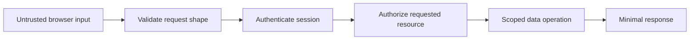

# Full-stack security

**Field note 01** · Browser → API → data

## Start with a specific failure

Imagine a workspace app with an endpoint that returns a document by ID. Alice and Bob each belong to a different workspace. Alice changes an ID in the request. Does the server return Bob’s document?

The interface can hide a button, but the server must enforce the resource boundary. A useful first security test is a request made by a valid user against a resource they do not own.



## Write the boundary down

| Boundary | Decision to make | Evidence to keep |
| :--- | :--- | :--- |
| Identity | How does the API verify the session? | Missing, invalid and expired session tests. |
| Workspace | Where is membership checked? | Cross-workspace read and write tests. |
| Input | Which fields and sizes are accepted? | Unknown-field and oversized-body tests. |
| Output | Which fields may leave the server? | Response assertions excluding internal fields. |
| Side effects | What happens if a request is repeated? | Duplicate-submission test and expected outcome. |

For a multi-tenant query, make the authorized workspace part of the data selection. Do not trust a workspace identifier merely because the browser sent it. Check the authenticated user’s membership first, then scope the query to that workspace.

For cookie-authenticated state changes, assess CSRF protection separately. CORS settings do not replace authentication, authorization or CSRF controls. See the [OWASP REST Security Cheat Sheet](https://cheatsheetseries.owasp.org/cheatsheets/REST_Security_Cheat_Sheet.html) for the underlying API controls.

## A compact test matrix

| Request | Expected behavior |
| :--- | :--- |
| No session | Reject before accessing protected data. |
| Valid session, permitted document | Return only the allowed response fields. |
| Valid session, another workspace’s document | Deny without returning the document. |
| Viewer attempts an edit | Deny even when the UI normally hides editing. |
| Invalid or oversized body | Reject with a controlled response. |
| Repeated create request | Follow the documented idempotency policy. |

Choose a consistent policy for `403` versus `404` when a resource exists but is inaccessible. Tests should encode that decision. Avoid revealing resource details in error messages.

## Review before release

- [ ] Protected reads and writes enforce authorization on the server.
- [ ] Tenant membership comes from verified server-side state.
- [ ] Database operations use parameters or safe query bindings.
- [ ] Input limits include file size, body size and pagination.
- [ ] Logs exclude passwords, tokens and unnecessary user content.
- [ ] Login and expensive operations have appropriate abuse controls.
- [ ] Errors give users a next step without exposing stack traces.
- [ ] Secrets are injected through the deployment environment.
- [ ] Cross-user and cross-workspace tests run in CI.

## Keep a decision record

```text
Feature:
Protected resource:
Allowed roles:
Server-side enforcement point:
Negative test:
Expected denial behavior:
Evidence / test result:
Unresolved decision:
```

Keep this record next to the change. It gives a reviewer something more useful than a general claim that a feature is secure.

[Back to the playbook](README.md)
