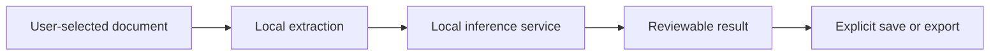

# Local AI product design

**Field note 02** · Make the data path visible

## Define what “local” means

A model can run on the device while crash reporting, remote fonts, analytics or a fallback service still sends data elsewhere. Define the boundary for the whole product, then test it.

Start with one workflow: a user selects a document, asks for a summary, reviews the result and chooses whether to save it. Every network request and stored copy should have a reason.



## Map the data before building the screen

| Data | Default decision to consider | Verification |
| :--- | :--- | :--- |
| Input documents | Process only user-selected files. | Inspect file access during the workflow. |
| Prompts and responses | Avoid storing full content by default. | Inspect logs, cache and application storage. |
| Model downloads | Separate setup traffic from inference. | Test after the model is installed and offline. |
| Cloud fallback | Require an explicit choice before sending content. | Disconnect the local service and observe behavior. |
| Diagnostics | Collect minimal operational information. | Inspect a sample report before enabling collection. |

For Ollama, confirm the behavior of the installed version using the [local FAQ](https://docs.ollama.com/faq). Keep the inference endpoint bound to loopback when it is intended only for the same machine. An app that exposes a model service to a network needs a separate access-control design.

## Design for the second minute

The first prompt is only part of the experience. Cold model loading, a full disk or an unavailable service can happen after the user has already invested effort.

| State | What the interface should explain | Useful next action |
| :--- | :--- | :--- |
| Model missing | A download is needed; show its known size. | Start or cancel setup. |
| Service unavailable | The local connection could not be established. | Retry or open setup guidance. |
| Loading | The model is being prepared. | Keep input intact; allow cancellation. |
| Generating | A response is in progress. | Stop generation. |
| Input too large | The current request exceeds supported limits. | Reduce the selection or use an explicit chunking flow. |
| Generation failed | No complete result was produced. | Retry without losing the original input. |

Cancellation should stop the underlying work where supported, rather than only hiding a spinner. Treat model output as untrusted text: do not automatically execute generated commands or interpret generated instructions as permission.

## Measure the experience

Use a small, fixed set of representative documents. Include a short input, a longer input, an empty extraction and a document containing instruction-like text.

```text
App / runtime version:
Model name and exact version:
Hardware and memory:
Input size / context setting:
Cold-start time:
Time to first output:
Total completion time:
Peak memory observed:
Task success / failure:
Cancellation result:
Network observations:
```

Compare results on the hardware you intend to support. A smooth demo on a development machine is not a minimum hardware requirement.

## Review before release

- [ ] The privacy explanation matches the observed data flow.
- [ ] Installed-model inference works without an internet connection.
- [ ] Missing models and failed downloads have explicit states.
- [ ] Input survives cancellation and recoverable failures.
- [ ] Model identity and relevant settings are recorded for evaluation.
- [ ] Deleting history removes the copies the app owns, as documented.
- [ ] No cloud fallback sends user content without a clear choice.

[Back to the playbook](README.md)
