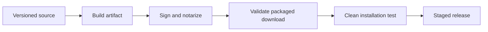

# macOS release readiness

**Field note 03** · Verify the artifact users actually download

## Treat distribution as part of the product

A release is more than a successful build. A user downloads an artifact, opens it, grants permissions and eventually updates it. Each step needs a defined success path and a useful failure path.

This guide focuses on direct distribution outside the Mac App Store. Apple’s [notarization documentation](https://developer.apple.com/documentation/security/notarizing-macos-software-before-distribution/) explains the Developer ID and notarization process. For Tauri applications, follow the framework’s [macOS signing guide](https://v2.tauri.app/distribute/sign/macos/).



## Define the release gate

| Gate | What to verify | Evidence |
| :--- | :--- | :--- |
| Identity | App identifier, version and signing identity agree. | Build metadata and signature inspection. |
| Download | The published file is the tested artifact. | Checksum and a fresh browser download. |
| Installation | The app opens under normal macOS protections. | Clean-user installation result. |
| Permissions | Prompts appear when a feature needs access. | Denied, granted and revoked permission cases. |
| Update | An older supported build can update successfully. | Version-to-version update record. |
| Recovery | Interrupted operations preserve user data. | Failure case with observed outcome. |

Use Apple’s signing and notarization tooling to inspect the artifact. These are verification examples, not a replacement for the full distribution procedure:

```sh
# Replace these example paths with your own built artifacts.
codesign --verify --strict --verbose=2 "/path/to/Example.app"
spctl --assess --type execute --verbose=2 "/path/to/Example.app"
xcrun stapler validate "/path/to/Example.dmg"
shasum -a 256 "/path/to/Example.dmg"
```

A ZIP itself is not stapled; supported items inside it need the appropriate notarization and stapling workflow before packaging. See Apple’s [custom notarization workflow](https://developer.apple.com/documentation/security/customizing-the-notarization-workflow).

## Test beyond the development account

- [ ] Download the artifact through the intended distribution channel.
- [ ] Install using a clean user account without development tools.
- [ ] Verify the minimum supported macOS version and each shipped architecture.
- [ ] Open the app with network access disabled where offline use is supported.
- [ ] Deny each requested permission and check the recovery guidance.
- [ ] Revoke a previously granted permission and retry the relevant feature.
- [ ] Test a supported previous version updating to the release candidate.
- [ ] Interrupt an update and verify the documented recovery behavior.
- [ ] Confirm application data survives the intended upgrade path.
- [ ] Verify uninstall instructions distinguish the app from user-owned files.

For Tauri, update signatures are a separate concern from Apple code signing. Follow the [updater documentation](https://v2.tauri.app/plugin/updater/) and test both the metadata and the downloaded bundle. Keep signing secrets outside the repository.

## Publish a useful release note

```text
Version / release date:
Supported macOS versions and architectures:
User-visible changes:
Known limitations:
Permission or migration changes:
Download checksums:
Verified upgrade path:
Recovery / support instructions:
```

Record what was actually tested. If a migration changes stored data, state the rollback limits before users install the release. Keeping an older download does not automatically make a changed data format reversible.

[Back to the playbook](README.md)
